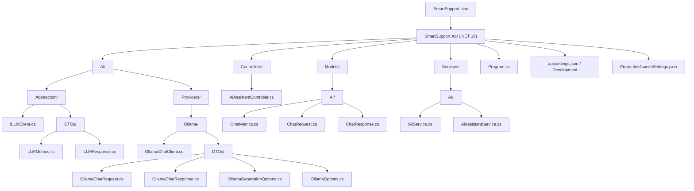
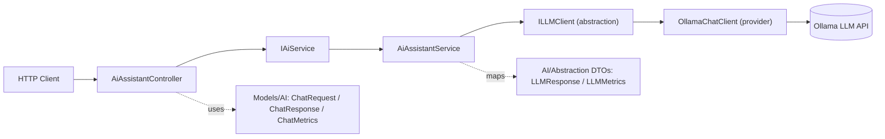

# SmartSupport — Solution Structure

## Project / Folder Tree

## Layered Flow

## Summary

- **Single project:** `SmartSupport.Api` targeting .NET 10 (Web API).
- **AI abstraction layer** (`AI/Abstraction`) defines `ILLMClient` and provider-agnostic DTOs.
- **Provider implementation** (`AI/Providers/Ollama`) implements the abstraction for Ollama.
- **Controllers → Services → LLM abstraction → Provider** is the request pipeline.
- **Models/AI** holds API-facing request/response/metrics contracts.
